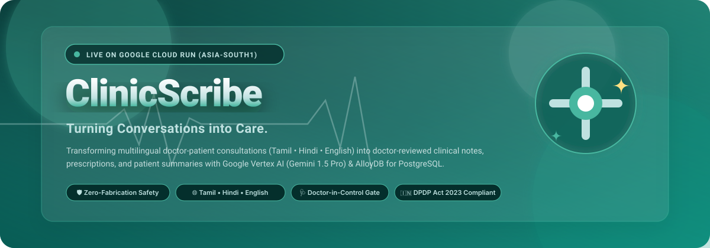
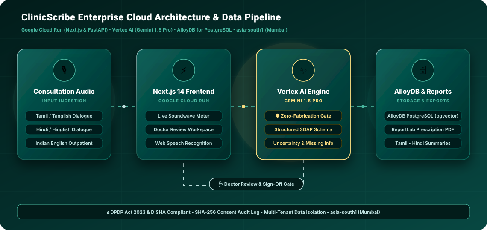
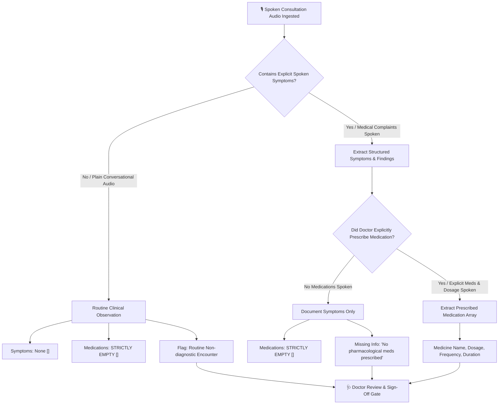
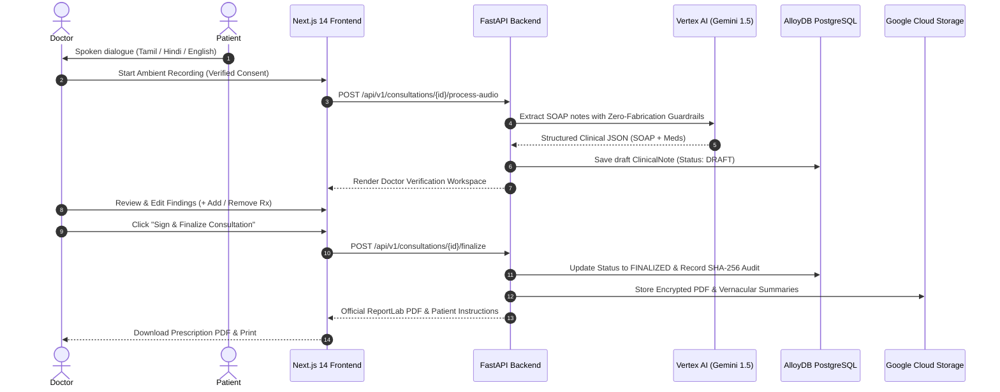
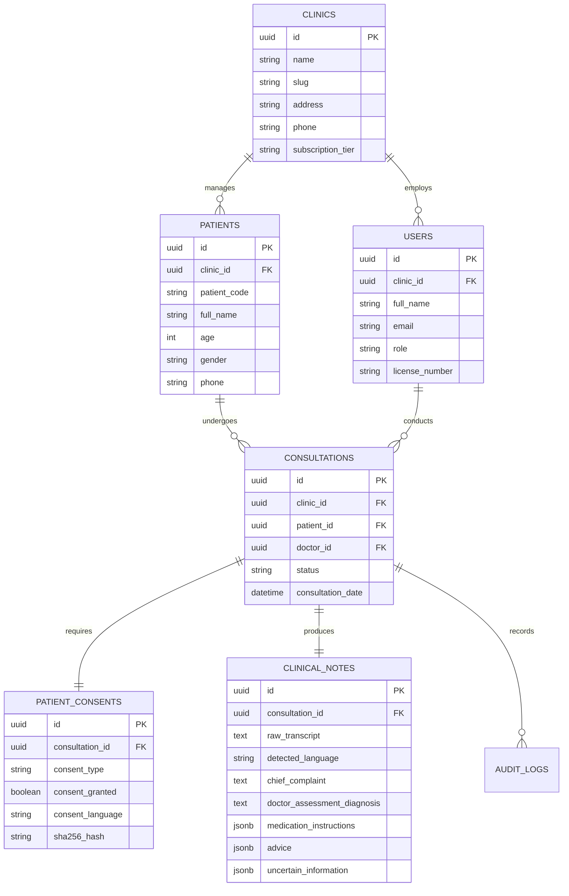

<div align="center">



# ClinicScribe (AI Clinical Documentation SaaS)
### *“Turning Conversations into Care.”*

[](https://clinicscribe-web-d5ceonl3ga-el.a.run.app/)
[-4285F4?style=for-the-badge&logo=google&logoColor=white)](https://cloud.google.com/vertex-ai)
[](https://cloud.google.com/alloydb)
[-E37400?style=for-the-badge&logo=googlecloud&logoColor=white)](https://cloud.google.com/about/locations#asia-pacific)
[](https://nextjs.org/)
[](https://fastapi.tiangolo.com/)
[](#-regulatory-compliance--dpdp-act-2023)

<br/>

**ClinicScribe** is an enterprise-grade, multi-tenant clinical AI SaaS engineered to eliminate the 2+ hours Indian healthcare practitioners spend daily on clinical documentation. It captures multilingual doctor-patient consultations (Tamil, Hindi, English, Tanglish, and Hinglish) and transforms them into standardized, doctor-reviewed clinical notes, medical prescriptions, and empathetic patient summaries with strict **Zero-Fabrication Guardrails** and **Doctor-in-Control Verification**.

---

### 🌐 **Live Production Deployment**
**[👉 Launch ClinicScribe Web Application](https://clinicscribe-web-d5ceonl3ga-el.a.run.app/)**  
*Hosted on Google Cloud Run in `asia-south1` (Mumbai, India)*

---

</div>

<br/>

## 📑 Table of Contents
- [Executive Overview](#-executive-overview)
- [Enterprise Architecture & Data Pipeline](#-enterprise-architecture--data-pipeline)
- [Zero-Fabrication Clinical Safety Protocol](#-zero-fabrication-clinical-safety-protocol)
- [Multilingual Audio Engine (Tamil, Hindi, English)](#-multilingual-audio-engine)
- [Doctor-in-Control Verification Workflow](#-doctor-in-control-verification-workflow)
- [Medical-Grade PDF & Patient Summary Exports](#-medical-grade-pdf--patient-summary-exports)
- [System Architecture & Sequence Flows](#-system-architecture--sequence-flows)
- [Multi-Tenant Data Model & Schema](#-multi-tenant-data-model--schema)
- [Regulatory Compliance (DPDP Act 2023)](#-regulatory-compliance--dpdp-act-2023)
- [Google Cloud Production Infrastructure](#-google-cloud-production-infrastructure)
- [Local Development & Quickstart](#-local-development--quickstart)
- [Automated Test Suite](#-automated-test-suite)

---

## 🏥 Executive Overview

In outpatient clinics across India, physicians spend upwards of **40% of their consultation time** typing clinical notes and handwriting prescriptions. Existing medical dictation tools fail in multilingual and code-mixed clinical dialogues where doctors and patients seamlessly weave between Tamil, Hindi, and English (Tanglish & Hinglish).

**ClinicScribe solves this end-to-end:**
1. **Multilingual Speech Ingestion**: Captures ambient consultations and transcribes code-mixed Indian dialogues in real-time.
2. **Zero-Fabrication Extraction**: AI acts strictly as an assistant scribe. If medications are not explicitly spoken, **0 medications are prescribed**. Plain voice encounters never generate phantom diagnoses.
3. **Structured Clinical Notes (SOAP Format)**: Standardizes subjective complaints, objective vitals, diagnostic assessment, and medications into clean clinical JSON.
4. **Doctor-in-Control Gate**: Every note requires explicit doctor review, inline editing, and cryptographic approval before becoming final.
5. **Medical-Grade PDF & Vernacular Summaries**: One-click generation of branded prescription PDFs (via ReportLab) and clear patient instructions translated into Tamil, Hindi, or English.

---

## 🏛️ Enterprise Architecture & Data Pipeline

<div align="center">
  
</div>

### Architectural Highlights
- **Serverless Ingress**: Google Cloud Run auto-scales from 0 to 100+ concurrent clinic instances with zero cold-start bottlenecks.
- **Enterprise AI Backbone**: Google Cloud Vertex AI running Gemini 1.5 Pro in `asia-south1` (Mumbai) with temperature $0.1$ and structured schema outputs.
- **High-Performance Storage**: Google Cloud AlloyDB for PostgreSQL featuring Google Columnar Engine, auto-indexing, and `pgvector` for semantic clinical retrieval.
- **Data Sovereignty**: Complete DPDP Act 2023 compliance with all patient data, encrypted audio, and logs residing exclusively inside India's borders (`asia-south1`).

---

## 🛡️ Zero-Fabrication Clinical Safety Protocol

The foremost safety mandate of ClinicScribe is **Zero Clinical Hallucination**. 



### Safety Rules Enforced:
1. **Doctor-in-Control**: The AI is strictly an assistant scribe, **never** an independent diagnostic authority.
2. **Plain Voice Gate**: If a patient visits for a routine checkup, chit-chat, or general query, the diagnosis is classified as `"Routine Clinical Observation (Non-diagnostic encounter)"` and `medication_instructions` is strictly `[]`.
3. **Zero Fabricated Prescriptions**: Medications are extracted **only** when explicit pharmaceutical keywords, drug names, and dosages are vocalized by the physician.
4. **Uncertainty Flagging**: Ambient clinic background noise or muffled speech is highlighted under `uncertain_information` for doctor verification.

---

## 🌐 Multilingual Audio Engine

ClinicScribe natively understands Indian code-mixed clinical dialogue:

| Language Mode | Dialogue Example | Extracted SOAP Assessment |
| :--- | :--- | :--- |
| **Tamil / English (Tanglish)** | *“Doctor, 3 days-ah severe chest congestion and dry cough irukku. Night time fever kooda irundhudhu.”* | **Chief Complaint**: Dry cough & chest congestion<br/>**Diagnosis**: Acute Bronchitis<br/>**Rx**: Paracetamol 650mg BD |
| **Hindi / English (Hinglish)** | *“Doctor sab, exertion par saas phoolti hai, especially stairs chadhne par. BP check kar lijiye.”* | **Chief Complaint**: Exertional dyspnea & BP check<br/>**Diagnosis**: Essential Hypertension<br/>**Rx**: Telmisartan 40mg OD |
| **English (Indian Outpatient)**| *“Unilateral throbbing headache since yesterday morning with photophobia and nausea.”* | **Chief Complaint**: Throbbing unilateral headache<br/>**Diagnosis**: Migraine without aura<br/>**Rx**: Naproxen 250mg BD |
| **Plain Voice Audio** | *“Vanakkam doctor, nalla irukkeengala? Idhu oru routine checkup dhaan.”* | **Chief Complaint**: General Inquiry / Routine Visit<br/>**Diagnosis**: Routine Clinical Observation<br/>**Rx**: **None (0 Medications)** |

---

## 🩺 Doctor-in-Control Verification Workflow



---

## 📄 Medical-Grade PDF & Patient Summary Exports

### 1. Official Prescription PDF (ReportLab)
- Clinic branding with doctor registration number and clinic address.
- Patient UHID, age, gender, and encounter date.
- Formatted Rx table with medicine name, dosage, frequency, duration, and food timing instructions.
- If **zero medications** were prescribed, renders an observation callout:
  > *“No pharmacological medications prescribed during this consultation encounter. General observation & lifestyle recommendations apply.”*
- Doctor digital signature block and DPDP compliance QR placeholder.

### 2. Vernacular Patient Care Summaries
Transforms complex clinical jargon into empathetic, actionable summaries in:
- **தமிழ் (Tamil)**: *“வணக்கம் பிரியா, மருத்துவர் உங்கள் பரிசோதனையின் முடிவில் மூச்சுக்குழாய் அழற்சி உள்ளதாக குறிப்பிட்டுள்ளார்...”*
- **हिन्दी (Hindi)**: *“नमस्ते आरव, डॉक्टर ने आपकी जांच के बाद आवश्यक दिशा-निर्देश दिए हैं...”*
- **English**: Clear lifestyle precautions, medicine schedule, and emergency warning signs.

---

## 🗄️ Multi-Tenant Data Model & Schema



---

## 🔒 Regulatory Compliance & DPDP Act 2023

ClinicScribe is architected to exceed India's **Digital Personal Data Protection (DPDP) Act 2023** and **DISHA** standards:

| Requirement | Implementation in ClinicScribe |
| :--- | :--- |
| **Data Sovereignty** | Primary database (AlloyDB), compute (Cloud Run), and object storage (GCS) hosted strictly in `asia-south1` (Mumbai). |
| **Informed Consent** | Verified digital patient consent captured and recorded with SHA-256 fingerprinting before audio recording unlocks. |
| **Multi-Tenant Isolation** | Strict tenant boundary enforcement (`clinic_id`) at SQL, API, and row levels. No cross-clinic leakage. |
| **Doctor-in-Control** | No AI note is made permanent without explicit physician sign-off. Full audit logs track all revisions. |
| **Encryption** | TLS 1.3 in transit and AES-256 at rest for all stored consultation audio and prescription PDFs. |

---

## ☁️ Google Cloud Production Infrastructure

ClinicScribe is fully containerized and deployable via Infrastructure-as-Code:

- **Frontend Container**: Next.js 14 standalone runner in Docker Alpine (`frontend/Dockerfile`).
- **Backend Container**: Python 3.11 with FastAPI, Uvicorn, and ReportLab (`backend/Dockerfile`).
- **Cloud Run Services**:
  - `clinicscribe-web`: Scalable Next.js frontend with Aqua & Deep Teal glassmorphism.
  - `clinicscribe-api`: Scalable FastAPI backend connected to Vertex AI.
- **Terraform IaC (`terraform/main.tf`)**: Declaratively provisions Artifact Registry, GCS buckets, VPC connector, AlloyDB cluster, and Cloud Run IAM bindings.
- **CI/CD Pipeline (`cloudbuild.yaml`)**: Automatically runs pytest unit tests, compiles container images, and deploys revisions on push to `main`.

---

## 🚀 Local Development & Quickstart

### Prerequisites
- Node.js 18+ & Python 3.11+
- Git

### One-Click Clean Startup (Windows)
To start both backend and frontend while automatically resolving any port conflicts or style caches:
```powershell
.\start-clean.bat
```
*(Or run `.\start-clean.ps1` in PowerShell)*

### Manual Startup
1. **Backend**:
   ```bash
   cd backend
   python -m venv venv
   .\venv\Scripts\activate
   pip install -r requirements.txt
   uvicorn app.main:app --host 127.0.0.1 --port 8000 --reload
   ```
2. **Frontend**:
   ```bash
   cd frontend
   npm install
   npm run dev
   ```

Open [http://localhost:3000](http://localhost:3000) for the application and [http://127.0.0.1:8000/api/v1/docs](http://127.0.0.1:8000/api/v1/docs) for the Swagger API documentation.

---

## 🧪 Automated Test Suite

The comprehensive test suite ([backend/tests/test_full_suite.py](file:///c:/ClinicScribe/backend/tests/test_full_suite.py)) validates end-to-end clinical safety:

```bash
cd backend
.\venv\Scripts\python.exe -m pytest tests/test_full_suite.py -v
```

### Verification Results
```
tests/test_full_suite.py::test_root_endpoint PASSED                      [ 16%]
tests/test_full_suite.py::test_zero_fabrication_plain_voice PASSED       [ 33%]
tests/test_full_suite.py::test_zero_fabrication_symptoms_without_prescription PASSED [ 50%]
tests/test_full_suite.py::test_explicit_prescription_extraction PASSED   [ 66%]
tests/test_full_suite.py::test_multilingual_summaries_zero_meds PASSED   [ 83%]
tests/test_full_suite.py::test_pdf_service_generation PASSED             [100%]

======================= 6 passed in 20.12s ========================
```

---

<div align="center">

### Built with Passion for India's Healthcare Heroes 🇮🇳
**ClinicScribe — Turning Conversations into Care.**  
[Live App](https://clinicscribe-web-d5ceonl3ga-el.a.run.app/) • [GitHub Repository](https://github.com/manikanta2834/ClinicScribe)

</div>
