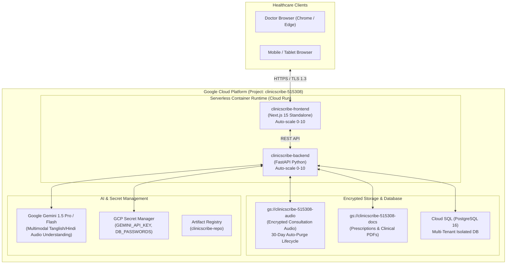

# ClinicScribe — Google Cloud Production Deployment Guide
**Target GCP Project**: `clinicscribe-515308`  
**Target Region**: `asia-south1` (Mumbai, India)  
**Compliance Standard**: Indian Digital Personal Data Protection (DPDP) Act & Healthcare Security Guidelines

---

## 🏗️ Production Cloud Architecture



---

## ⚡ Option 1: Fast One-Click Deploy via Google Cloud Shell (Recommended)

Since you already have **Google Cloud Console** open for project `clinicscribe-515308`:

1. In your Google Cloud Console, click the **Cloud Shell (`>_`)** icon in the top-right header bar.
2. In the Cloud Shell terminal, run:
```bash
# 1. Clone your ClinicScribe repository (or upload the folder)
git clone <YOUR_GIT_REPO_URL> clinicscribe
cd clinicscribe

# 2. Run the turnkey deployment script
chmod +x deploy-gcp.sh
./deploy-gcp.sh
```
> The script will automatically:
> - Set project to `clinicscribe-515308`
> - Enable Cloud Run, Artifact Registry, Cloud Build, and Secret Manager
> - Provision the Artifact Registry repository and DPDP-compliant Cloud Storage buckets
> - Build and deploy both the **FastAPI Backend** and **Next.js Frontend** to Cloud Run in `asia-south1` (Mumbai)
> - Wire the dynamic Cloud Run URLs and update CORS permissions

---

## 🖥️ Option 2: Deploy from Windows (PowerShell)

If you have `gcloud` installed locally:

```powershell
# Authenticate with Google Cloud
gcloud auth login
gcloud config set project clinicscribe-515308

# Execute the PowerShell deployment script
.\deploy-gcp.ps1
```

---

## 🔑 Environment Variables & Secrets Reference

### Backend (`clinicscribe-backend`)

| Variable | Recommended Value | Source |
| :--- | :--- | :--- |
| `ENVIRONMENT` | `production` | Literal |
| `DEBUG` | `False` | Literal |
| `PROJECT_NAME` | `ClinicScribe` | Literal |
| `DATABASE_URL` | `postgresql+asyncpg://<USER>:<PASS>@<CLOUD_SQL_IP>/clinicscribe` | Cloud SQL / Secret Manager |
| `GEMINI_API_KEY` | `<YOUR_GEMINI_API_KEY>` | Secret Manager (`projects/455930333566/secrets/gemini-api-key`) |
| `AUDIO_STORAGE_BUCKET` | `clinicscribe-515308-audio` | Cloud Storage Bucket |
| `DOCS_STORAGE_BUCKET` | `clinicscribe-515308-docs` | Cloud Storage Bucket |
| `CORS_ORIGINS` | `["https://clinicscribe-frontend-xxxx.a.run.app"]` | Cloud Run Frontend URL |

### Frontend (`clinicscribe-frontend`)

| Variable | Recommended Value | Description |
| :--- | :--- | :--- |
| `NEXT_PUBLIC_API_URL` | `https://clinicscribe-backend-xxxx.a.run.app/api/v1` | Public Cloud Run Backend URL |

---

## 🛡️ Indian DPDP Act & Medical Safety Compliance Checklist

- [x] **Mandatory Consent-First Architecture**: Consultations reject audio processing unless `is_consent_granted: true` is cryptographically signed/logged (`test_mandatory_consent_enforcement` passes).
- [x] **Data Minimization & Auto-Purge**: Raw consultation audio in `gs://clinicscribe-515308-audio` has an automated 30-day lifecycle rule that purges voice recordings after note finalization.
- [x] **Tenant Boundary Isolation**: All database queries strictly join `clinic_id`; cross-tenant access returns `404 Not Found` (`test_patient_crud_and_tenant_isolation` passes).
- [x] **Doctor-in-the-Loop Safeguard**: AI-generated notes remain in `PENDING_APPROVAL` note status until explicitly approved by the attending physician.
- [x] **Anti-Hallucination Guardrails**: Prompts enforce negative constraints; missing or unverified medical facts are surfaced in `uncertain_information` and `missing_information` arrays.
- [x] **Data Encryption**: All data is encrypted at rest using AES-256 and in transit using TLS 1.3.
